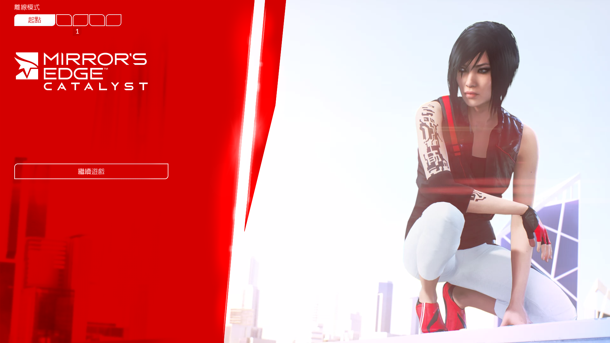
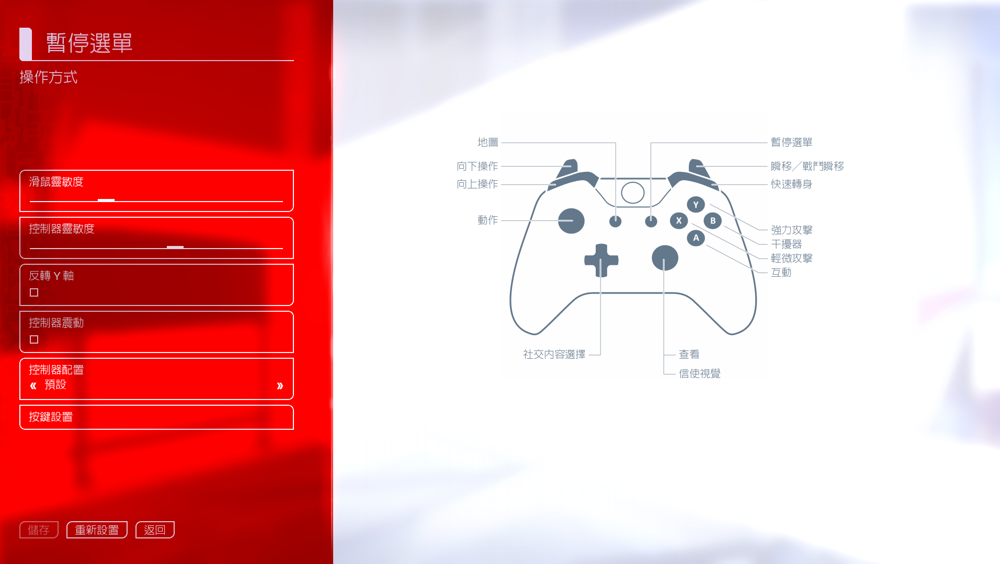
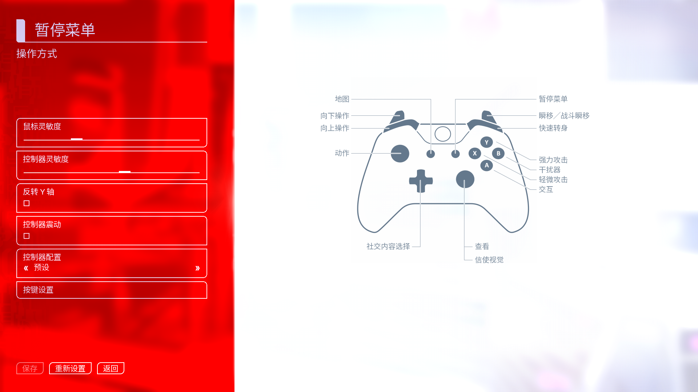
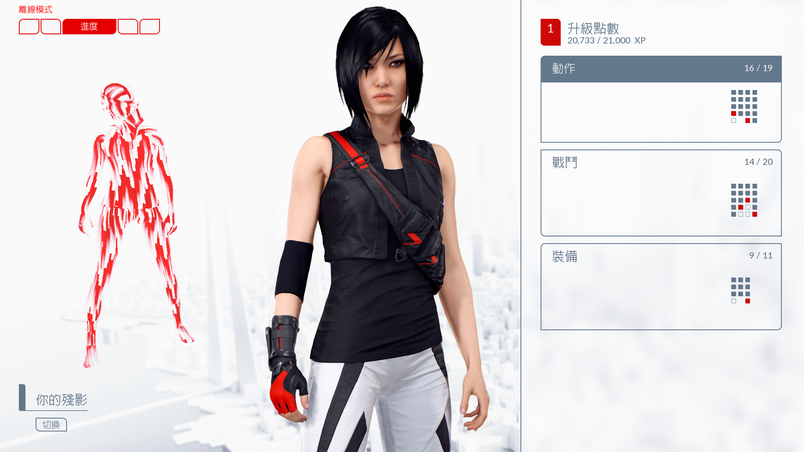
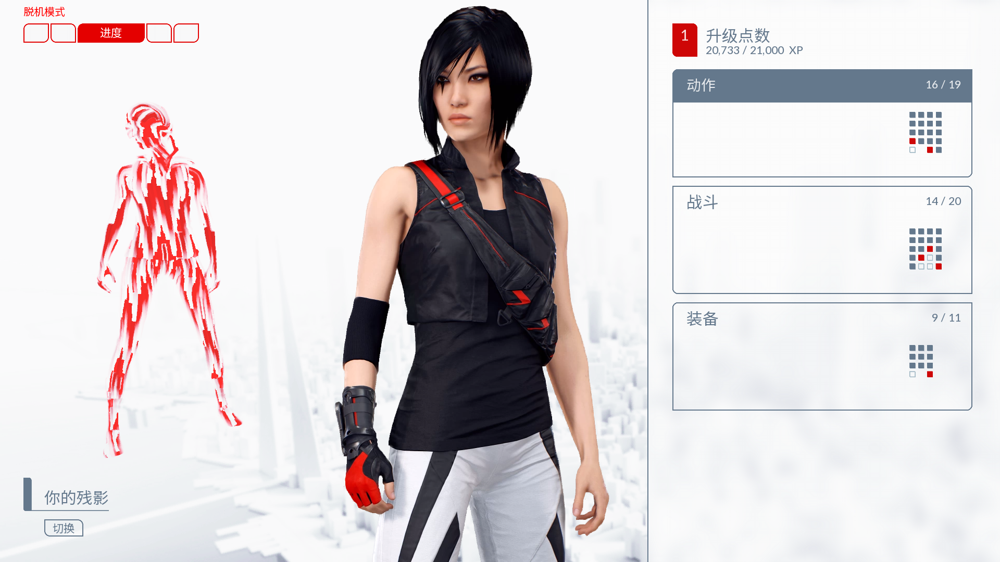

# 案例：《镜之边缘：催化剂》官方繁体转简体

本案例来自正版 Steam 安装的实际制作及使用者运行反馈。以下六张截图由使用者提供，三组对应关系经过人工检查；没有上传完整游戏文本、资源容器或账户配置。

## 主菜单

| 官方繁体 | 转换后简体 |
|---|---|
|  |  |

例如“繼續遊戲”转换为“继续游戏”。

## 操作设置

| 官方繁体 | 转换后简体 |
|---|---|
|  |  |

可观察“暫停選單”“滑鼠靈敏度”等 UI 文案的转换，以及原界面层级和手柄图标的保留。用语变化来自 OpenCC tw2sp，不是重新翻译剧情。

## 进度页面

| 官方繁体 | 转换后简体 |
|---|---|
|  |  |

例如“進度”“戰鬥”“裝備”对应“进度”“战斗”“装备”。两张截图为同类页面的实际游戏截图，并非逐像素控制变量实验。

## 构建与验证记录

| 检查 | 本地记录 |
|---|---|
| 来源 | Steam Catalyst，AppID 1233570，记录 buildid 10351434 |
| 资源 | Localization/fs_zh_loc，FsUITextDatabase，官方繁体中文 |
| 导出 | 7978 行，7977 唯一 ID；保留一组相同 ID 的重复行 |
| 转换 | 6162 行变化；9 行原有空文本保留 |
| 编码 | 补充 783 个字符，SDK 独立读回验证 |
| 字体 | 统一 13780 个汉字码点为同一字形设计；目标语料 2135 个不同汉字，缺字 0 |
| 空环境复测 | 空依赖/工作目录，重新下载可信资源并重新导出；30 项脚本测试通过 |
| 实际运行 | 使用者确认 0.4.0 包启动后为简体，并已退出 |

这证明记录版本及已观察页面可用，不等于全部字幕、任务和剧情已逐句校对；截图也未单独证明一键安装 EXE 的启用/恢复完整循环在真实安装中验证。

## 曾经遇到的问题及解决方法

| 现象 | 原因 | 处理 |
|---|---|---|
| 导入包后仍然繁体 | 已导入但未应用，生成清单为空 | 分别检查包、启用状态、生成清单和启动链 |
| 文本空白或方框 | 引擎编码表与实际字体是两套覆盖要求 | 分开补充编码并审计实际绑定字体 |
| 一句话粗细不一致 | 原字形与补入字形的设计/字重混用 | 统一汉字设计，保留原英文、数字、图标和布局度量 |
| 普通方括号文字残留繁体 | 保护规则把可见文本误当占位符 | 仅按实际引擎语法保护，增加合成回归测试 |
| 专名语义改变 | tw2sp 词语转换不符合游戏专名 | 在该游戏的术语表中明确约束，不变成所有游戏的通用规则 |

更多资源编号和技术步骤见 skill 中的 [技术案例](../skills/game-traditional-to-simplified/references/catalyst-case.md) 与 [自动流程](../skills/game-traditional-to-simplified/references/automation.md)。
